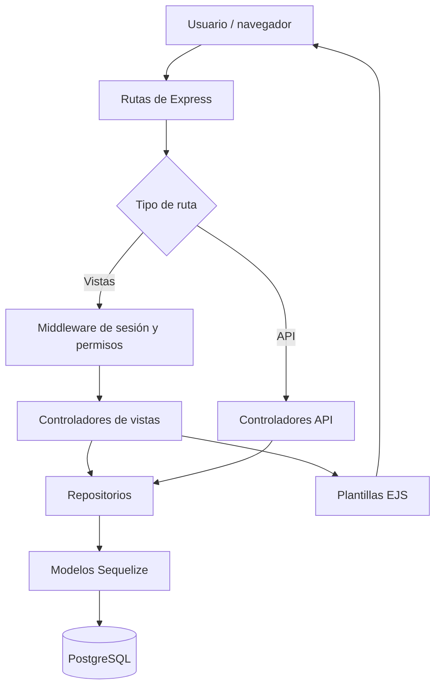
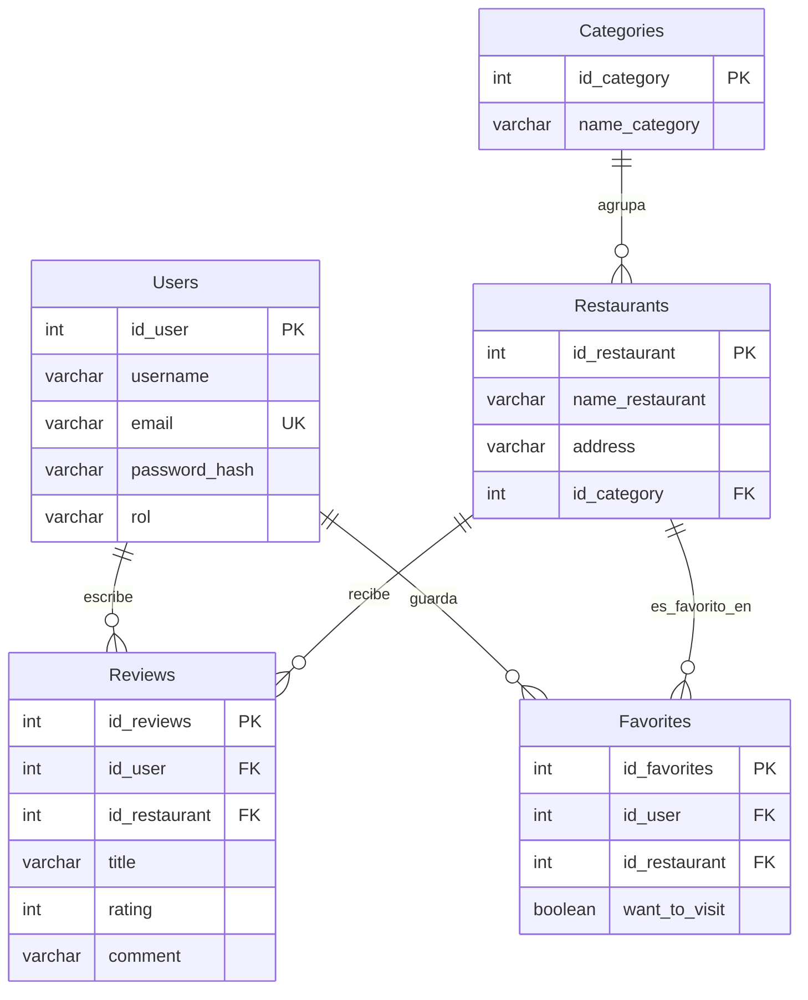
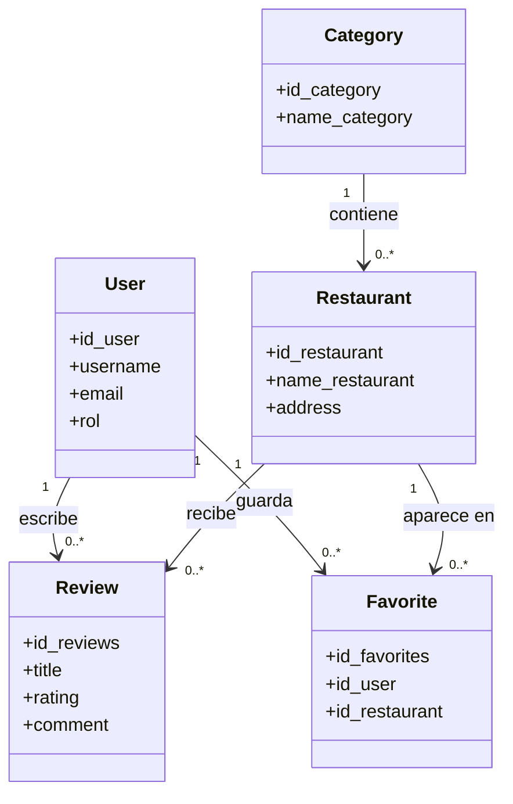
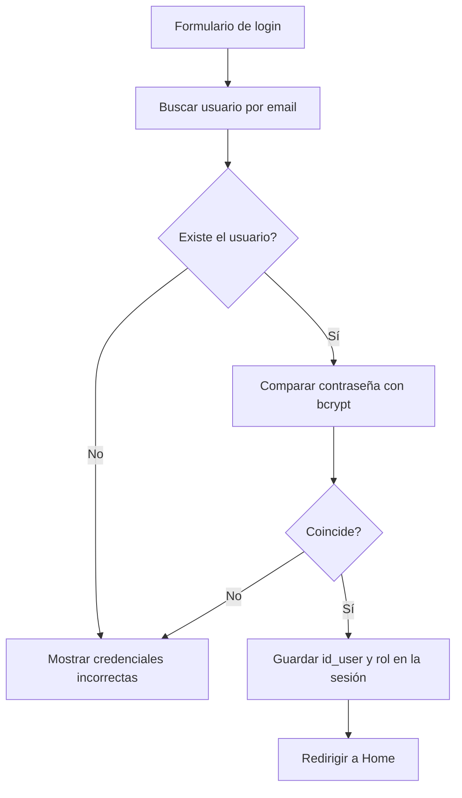

# SaltyReviews — Memoria del proyecto

> **Aplicación web de reseñas de restaurantes** · Proyecto grupal de desarrollo backend  
> **Tecnologías:** Node.js, Express, EJS, PostgreSQL, Sequelize, Docker y Git/GitHub.

## 1. ¿Qué es SaltyReviews?

SaltyReviews es una aplicación web en la que podemos descubrir restaurantes, consultar sus reseñas y puntuaciones, y guardar nuestros favoritos. También permite registrarse, iniciar sesión y gestionar contenidos según los permisos de cada usuario.

Nuestro objetivo era construir una aplicación completa, conectada a una base de datos y organizada en módulos, poniendo en práctica lo aprendido durante el curso. Además de que cada funcionalidad trabajase por separado, queríamos que **todo encajase al utilizar la web**.

## 2. Cómo fue evolucionando

El desarrollo fue progresivo, con cambios y correcciones a medida que integrábamos las distintas partes:

| Etapa | Qué hicimos y qué aprendimos |
|---|---|
| **Preparación** | Estructura inicial, dependencias, Docker, PostgreSQL, esquema SQL y datos de prueba. |
| **Primeros CRUD** | Usuarios, reseñas y restaurantes; rutas separadas para vistas y API. |
| **Organización del código** | Incorporamos modelos Sequelize, repositorios y controladores. Adaptamos funciones que inicialmente estaban planteadas de otra manera. |
| **Integración** | Relacionamos usuarios con reseñas, restaurantes con categorías y favoritos con usuarios y restaurantes. |
| **Autenticación** | Añadimos registro, login, sesiones, contraseñas cifradas y permisos para usuarios y administradores. |
| **Mejoras** | Gestión de errores, validaciones, navegación, filtros por categoría, puntuaciones, tarjetas y estilos. |
| **Documentación** | Memoria del proyecto y documentación técnica mediante JSDoc. |

### Una decisión que cambiamos: los favoritos

Al principio pensamos en un booleano en la tabla de restaurantes para indicar si uno estaba marcado como favorito. Nos dimos cuenta de que **cada persona tiene sus propios favoritos**: un valor guardado directamente en el restaurante no permitiría distinguir usuarios.

Por eso utilizamos la tabla `Favorites`, que relaciona `Users` y `Restaurants`. Cada relación representa un restaurante guardado por una persona, y el botón de corazón se marca o desmarca según exista esa relación. La idea inicial evolucionó hacia un diseño más útil y coherente.

## 3. Tecnologías utilizadas

| Herramienta | Uso en el proyecto |
|---|---|
| **Node.js y Express** | Servidor web, rutas y peticiones HTTP. |
| **EJS, HTML y CSS** | Páginas dinámicas, formularios, tarjetas y diseño visual. |
| **PostgreSQL** | Almacenamiento de usuarios, restaurantes, reseñas, categorías y favoritos. |
| **Sequelize** | Modelos, asociaciones y consultas a la base de datos. |
| **express-session y bcrypt** | Sesiones de usuario y cifrado de contraseñas. |
| **Docker Compose y pgAdmin** | Entorno de desarrollo reproducible y administración de PostgreSQL. |
| **Git y GitHub** | Desarrollo por ramas, integración de cambios y Pull Requests. |
| **JSDoc** | Documentación de las funciones y módulos del proyecto. |

## 4. Organización y arquitectura

Separamos las **vistas** (HTML generado con EJS) de la **API** (respuestas JSON). Ambas utilizan controladores y repositorios que trabajan con los modelos de Sequelize.



### Estructura principal de carpetas

```text
SaltyReviews/
├── public/
│   └── css/                 # Estilos de la aplicación
├── sql/
│   ├── 01_schema.sql        # Tablas y relaciones
│   └── 02_seed.sql          # Datos iniciales
├── src/
│   ├── config/              # Conexión con PostgreSQL
│   ├── models/              # Modelos y asociaciones Sequelize
│   ├── repositories/        # Consultas y operaciones con datos
│   ├── controllers/         # Lógica para vistas y API
│   │   ├── auth/
│   │   ├── user/
│   │   ├── restaurant/
│   │   ├── review/
│   │   ├── category/
│   │   ├── favorite/
│   │   └── home/
│   ├── routes/
│   │   ├── view/            # Rutas de páginas EJS
│   │   └── api/             # Rutas que devuelven JSON
│   ├── views/               # Formularios, listados, fichas y layout
│   ├── middlewares/         # Autenticación y permisos
│   ├── utils/               # Gestión común de errores
│   └── index.js             # Arranque de Express
├── doc/                     # Documentación del proyecto
├── docker-compose.yml
├── Dockerfile
└── package.json
```

## 5. Base de datos y relaciones SQL

La base de datos tiene cinco tablas principales. `Reviews` guarda quién escribió cada reseña y sobre qué restaurante; `Favorites` vincula un usuario con un restaurante. Un restaurante pertenece a una categoría.



**Detalles del esquema:** `Users.email` es único; en `Favorites` la pareja `(id_user, id_restaurant)` también es única para evitar guardar dos veces el mismo restaurante. Las tablas incluyen fechas de creación y actualización (omitidas del diagrama para facilitar la lectura). Las claves foráneas utilizan `ON DELETE NO ACTION`, de modo que pueden impedir borrar registros que tienen otros relacionados.

### Diagrama UML de los modelos

Este diagrama representa los objetos principales utilizados por Sequelize y sus asociaciones:



## 6. Funcionalidades principales

- **Usuarios y autenticación:** registro, inicio y cierre de sesión; perfiles y operaciones CRUD. Las contraseñas se almacenan cifradas con bcrypt.
- **Restaurantes:** listado, ficha individual, gestión por administradores, filtros de categoría y puntuaciones medias a partir de las reseñas.
- **Reseñas:** publicación asociada al usuario y al restaurante; consulta, edición y eliminación con control de autoría.
- **Categorías:** clasificación de restaurantes y gestión restringida a administradores.
- **Favoritos:** cada usuario puede marcar o desmarcar restaurantes y gestionar su lista personal.
- **API:** rutas diferenciadas de las vistas para trabajar con los datos en JSON.

Los permisos se aplican principalmente en las **rutas de vistas** mediante `auth.middleware.js`: algunas páginas son públicas; las acciones personales exigen sesión; y las operaciones administrativas requieren el rol `admin`. En las reseñas también se comprueba si la persona es la autora. La API está separada y no utiliza el mismo sistema de autorización de vistas en la versión revisada.

### Ejemplo: flujo de inicio de sesión



## 7. Validaciones, errores y pruebas

Se añadieron `try/catch` en repositorios y controladores y un módulo común, `src/utils/errors.js`, para transformar errores de Sequelize en respuestas más comprensibles. Entre los casos tratados están los **400** (datos incorrectos), **403** (sin permisos), **404** (recurso no encontrado) y **409** (conflictos, duplicados o relaciones que impiden un borrado).

Fuimos comprobando las funciones desde el navegador: registro y login, formularios con datos incompletos, emails repetidos, permisos según el rol, reseñas propias o ajenas, favoritos inexistentes y eliminación de registros relacionados. Estas pruebas ayudaron a encontrar fallos de rutas, variables EJS, importaciones y asociaciones. **Son pruebas funcionales manuales**; el proyecto no incluye todavía una suite de tests automatizados configurada.

## 8. Trabajo en equipo: dificultades y aprendizaje

Nos organizamos por funcionalidades y trabajamos en ramas de Git, integrando los cambios mediante Pull Requests hacia `dev`. El historial muestra cómo pasamos de la estructura inicial a los CRUD, las relaciones entre modelos, la autenticación, los permisos, la gestión de errores y los estilos.

**Al principio fue un poco caótico seguir el recorrido de los archivos.** A veces costaba entender por dónde pasaba una petición: ruta, middleware, controlador, repositorio, modelo y vista. Además, al juntar ramas aparecían conflictos e importaciones que dejaban de funcionar. Poco a poco, al trabajar sobre cada módulo y probarlo de principio a fin, fuimos entendiendo mejor la estructura y cómo se conectaban todas las partes.

También aprendimos que integrar no es solo juntar archivos: hay que comprobar que las funcionalidades desarrolladas por distintas personas siguen funcionando juntas.

## 9. Documentación con JSDoc

Además de esta memoria, el proyecto cuenta con **documentación técnica en JSDoc**, para explicar qué hace cada función, sus parámetros, sus resultados y los errores que puede producir. Se utiliza especialmente en:

- `src/utils/errors.js`: clases y funciones de gestión de errores.
- `src/middlewares/auth.middleware.js`: comprobaciones de sesión, roles y permisos.
- `src/models/models.js`: modelos y relaciones entre entidades.
- `src/repositories/*.repository.js`: operaciones de acceso a datos de todos los módulos.

Así, **la memoria explica el proyecto y su evolución**, mientras que **JSDoc facilita entender y mantener el código**.

## 10. Conclusiones y próximos pasos

SaltyReviews nos ha servido para practicar el desarrollo de una aplicación conectada a una base de datos real, organizar el backend por capas y trabajar en equipo con Git. Una de las lecciones más importantes ha sido que algunas decisiones iniciales debían revisarse cuando aparecían necesidades reales, como ocurrió con los favoritos.

Como siguientes mejoras posibles quedan ampliar las pruebas automatizadas (tests), revisar de forma conjunta el tratamiento de errores de todos los módulos y mejorar la API e implementar JWT.

---


